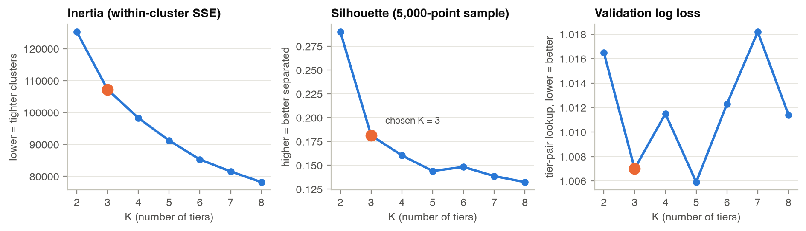
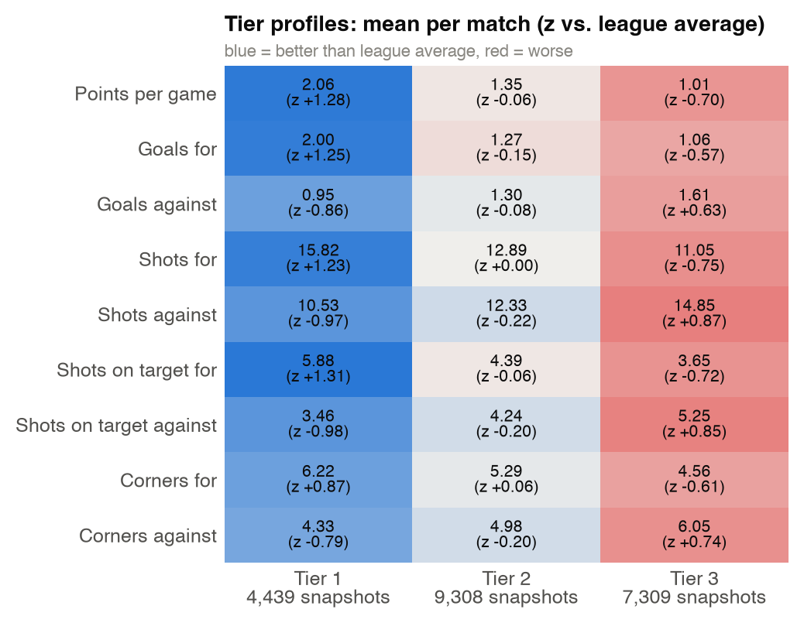
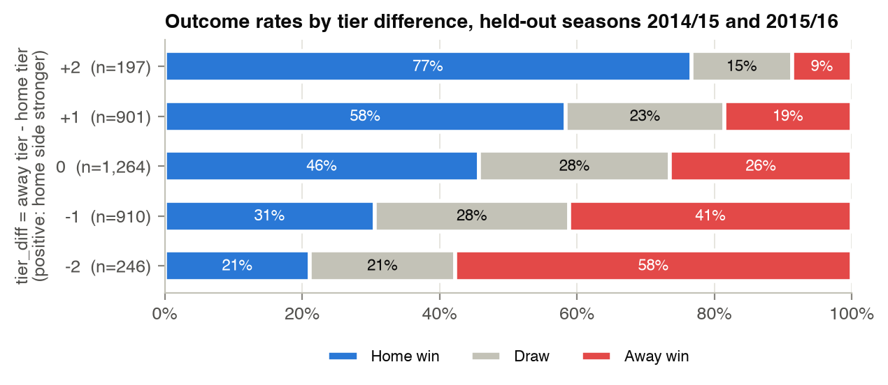

# Predicting Soccer Match Outcomes with Team Tiers and Classification

**AI 3642 Midterm Report**

| Group member | NetID | Part |
|---|---|---|
| Ryann Ridgeway | rridgew4 | Machine learning: outcome classifier |
| Khadim Drame | kdrame1 | Data mining: team tiers; data pipeline |

Code: <https://github.com/khadimswe/gambling-predictions>. Every number below is produced
by a command in that repository (`make tiers`, `soccer train`).

> **Draft status.** Sections marked `[RYANN: ...]` are Ryann's to write. Delete this note
> and every marker before submitting. `make text` must pass (no em dashes).

## 1. Task

Before kickoff, predict whether a league match ends in a **home win (H), draw (D), or away
win (A)**, using only information available before the match. We split the problem along
the two course areas named in our proposal:

- **Data mining (Khadim):** summarize each team's recent performance as a *tier* by
  clustering its rolling statistics with k-means.
- **Machine learning (Ryann):** a classifier that takes the tiers plus the raw rolling
  statistics of both teams and outputs P(H), P(D), P(A).

We evaluate with accuracy, macro-F1, log loss, and confusion matrices, against the
proposal's baseline (always predict a home win) and a bookmaker reference.

## 2. Data

**Source.** We used football-data.co.uk, which the proposal named as the fallback source.
We took the five largest leagues in the Kaggle European Soccer Database over the same
seasons (Premier League, La Liga, Bundesliga, Serie A, Ligue 1; 2008/09 to 2015/16).
football-data.co.uk has per-match shots, shots on target, corners, fouls, and cards as
plain CSV files. It does
not have possession, so we use shot and corner volume to describe which team controls
the game.

**Cleaning.** 40 files, 14,616 rows. We drop 8 blank trailing rows and 4 matches with
missing statistics, which leaves **14,604 matches**. Dates come in two formats
(dd/mm/yy and dd/mm/yyyy) and are parsed as both.

**A data-mining finding: a hidden definition change.** In the Premier League the share
of shots counted as "on target" falls from 55.6% (2008/09 to 2012/13) to 33.2% in
2013/14 and stays there. The other four leagues stay between 32% and 37% the whole time,
so this looks like a change in how the provider counts shots on target, not a change in
how teams play. Left alone, this made strong Premier League teams
in our test seasons look below average on shots on target (Man City's 4.8 per game
scored z = -0.94). We rescale Premier League shots on target before 2013/14 by
0.332 / 0.556 = **0.597**, a factor estimated only from training seasons. Afterwards
every league-season sits between 32% and 37%.

**Split by time, never shuffled.** Train: 2008/09 to 2013/14. Validation: 2014/15
(used to choose K and the window). Test: 2015/16.

| | Train | Validation | Test |
|---|---|---|---|
| Matches with features | 10,365 | 1,758 | 1,760 |
| Home win / draw / away win | 46.8% / 25.5% / 27.7% | 45.2% / 25.5% / 29.2% | 44.9% / 25.6% / 29.5% |

721 matches are dropped because one team had fewer than 5 earlier matches in its current
top-flight spell (start of 2008/09, and newly promoted teams).

## 3. Proposed model and algorithm

### 3.1 Overview

```
Model A (Khadim): data mining
  raw matches -> rolling form x per team, before each match
              -> standardize within league -> k-means -> tier t in {1, 2, 3}

Model B (Ryann): machine learning
  match m: [x_home, x_away, t_home, t_away, t_away - t_home]
              -> classifier -> P(H), P(D), P(A)
```

### 3.2 Model A: team tiers with k-means (Khadim)

**Unit of analysis.** A *team-match snapshot*: team i just before its match m. Each
match gives two snapshots, one per side. The training seasons give **N = 21,056**
snapshots.

**Variables.** For snapshot (i, m), the form vector x<sub>i,m</sub> has 9 entries, each a
mean over team i's previous W = 10 matches (home and away), using only matches played
before m:

| # | Variable | Meaning |
|---|---|---|
| 1 | ppg | points per game (win 3, draw 1, loss 0) |
| 2, 3 | gf, ga | goals for, goals against |
| 4, 5 | sf, sa | shots for, shots against |
| 6, 7 | sotf, sota | shots on target for, against |
| 8, 9 | cf, ca | corners for, against |

At least 5 previous matches are required. A team that missed a season (relegated, then
promoted again) starts a new *spell* with no history, so form from years ago never carries
over.

**Standardization per league.** For league l, μ<sub>l</sub> and σ<sub>l</sub> are the
mean and standard deviation of each variable over that league's training snapshots.
z<sub>i,m</sub> = (x<sub>i,m</sub> - μ<sub>l</sub>) / σ<sub>l</sub>. A team is therefore
judged against its own league (Bundesliga games have more goals than Serie A games), and
no validation or test data enters the scaling.

**Objective.** Choose an assignment a<sub>n</sub> in {1, ..., K} for every snapshot n and
centroids c<sub>1</sub>, ..., c<sub>K</sub> in R<sup>9</sup> to minimize the
within-cluster sum of squares

  J = Σ<sub>n=1..N</sub> ‖ z<sub>n</sub> - c<sub>a<sub>n</sub></sub> ‖²

**Algorithm (Lloyd's algorithm with k-means++ initialization).** The algorithm's state
is the pair (assignments a<sub>1..N</sub>, centroids c<sub>1..K</sub>).

```
Input: standardized training snapshots z_1..z_N in R^9 (N = 21,056), K = 3
1. k-means++ start: c_1 = a random snapshot. Each next centroid is a snapshot drawn
   with probability proportional to D(z)^2, its squared distance to the nearest
   centroid chosen so far. (Spreads the starting centroids out.)
2. Repeat until no assignment changes:
     Assign: a_n = argmin_k ||z_n - c_k||^2          for every snapshot n
     Update: c_k = mean of { z_n : a_n = k }          for every cluster k
3. Do steps 1-2 from 10 different starts; keep the run with the smallest J.
4. Order the clusters by their members' mean ppg: highest = tier 1, lowest = tier K.
5. Freeze mu_l, sigma_l and c_1..c_K. For any later snapshot (validation, test, or a
   live match), tier = index of the nearest centroid.
```

The assign step can only lower J (each point moves to a closer centroid) and the update
step can only lower J (the mean minimizes squared distance), so J never increases and the
loop ends after finitely many steps. Each iteration costs O(N · K · 9). Step 4 matters:
k-means numbers clusters arbitrarily, and ordering by strength turns the label into an
ordinal feature the classifier can use.

**Output features for match m** (home team h, away team a): `home_tier` = t<sub>h,m</sub>,
`away_tier` = t<sub>a,m</sub>, and `tier_diff` = t<sub>a,m</sub> - t<sub>h,m</sub>
(positive when the home side is in a stronger tier).

**How we judge the tiers on their own** (before Ryann's classifier):

- *Tier-pair lookup model:* P(y | t<sub>h</sub>, t<sub>a</sub>) estimated from training
  match counts in each of the K x K cells, with add-one smoothing. Its validation log loss
  measures how much outcome information the tiers carry.
- *Tier rule:* predict H unless the away team is in a stronger tier, then predict A.
- *Sanity check:* the correlation between a team's average tier over a season and its
  final points total.

**Choosing K and W.** We tried K = 2 to 8 and W in {5, 10, 15, 20}, scoring each on the
validation season (Section 4.1).

### 3.3 Model B: outcome classifier (Ryann)

`[RYANN: Describe the classifier precisely for this problem. Spec: docs/specs/ryann-classifier.md, "Your midterm report sections", item 1.]`

Fixed by the data contract, so that Model B builds on Model A:

- Input for match m: x<sub>m</sub> in R<sup>25</sup> = the 11 home form features
  (the 9 above plus fouls and yellow cards), the 11 away form features, `home_tier`,
  `away_tier`, `tier_diff`.
- Output: y<sub>m</sub> in {H, D, A}, encoded 0, 1, 2.
- `[RYANN: multinomial Logistic Regression: P(y = k | x) = exp(w_k · x + b_k) / Σ_j exp(w_j · x + b_j); what is learned, loss, regularization, optimizer.]`
- `[RYANN: Random Forest: trees, bootstrap, split criterion, max_features, how votes become probabilities.]`
- `[RYANN: why scaling, how draws / class imbalance are handled.]`

### 3.4 Concrete example

#### A. Lloyd's algorithm step by step on six real teams

To make the iterations visible we use only two variables (ppg and shots on target for)
and K = 2, for six Premier League teams just before their matches on 6 and 7 February
2016. Standardization uses the Premier League training statistics (ppg: μ = 1.384,
σ = 0.543; sotf: μ = 4.195, σ = 1.082).

| Team | ppg (last 10) | sotf (last 10) | z<sub>ppg</sub> | z<sub>sotf</sub> |
|---|---|---|---|---|
| Man City | 1.8 | 4.8 | 0.766 | 0.559 |
| Leicester | 2.1 | 4.2 | 1.319 | 0.004 |
| Tottenham | 2.0 | 6.7 | 1.135 | 2.316 |
| Arsenal | 1.8 | 4.9 | 0.766 | 0.651 |
| Aston Villa | 0.8 | 3.9 | -1.077 | -0.273 |
| Norwich | 1.0 | 2.7 | -0.708 | -1.382 |

Start: k-means++ would pick spread-out starting centroids at random; to keep the example
reproducible we fix them to two of the teams, c<sub>A</sub> = Man City (0.766, 0.559) and
c<sub>B</sub> = Aston Villa (-1.077, -0.273).

| Team | Iteration 1: d² to c<sub>A</sub>, c<sub>B</sub> | Assigned | Iteration 2: d² to c<sub>A</sub>, c<sub>B</sub> | Assigned |
|---|---|---|---|---|
| Man City | 0.000, 4.089 | A | 0.158, 4.674 | A |
| Leicester | 0.613, 5.817 | A | 0.875, 5.584 | A |
| Tottenham | 3.221, 11.592 | A | 2.073, 13.990 | A |
| Arsenal | 0.009, 4.251 | A | 0.106, 4.939 | A |
| Aston Villa | 4.089, 0.000 | B | 5.634, 0.342 | B |
| Norwich | 5.943, 1.367 | B | 8.037, 0.342 | B |
| **J** | **5.210** | | **3.896** | |

For example, Leicester to c<sub>A</sub> in iteration 1: (1.319 - 0.766)² + (0.004 - 0.559)²
= 0.306 + 0.308 = 0.613. After iteration 1 the update step moves the centroids to the
member means: c<sub>A</sub> = mean of the top four = (0.997, 0.883), c<sub>B</sub> =
(-0.892, -0.828). Iteration 2 assigns every team to the same cluster again, so the
centroids do not move and the algorithm stops. J fell from 5.210 to 3.896.

#### B. The full model on one match: Man City vs Leicester, 6 February 2016

The real model uses all 9 variables, K = 3, and the 21,056 training snapshots. Leicester
won this match 3-1 on their way to the 2015/16 title.

**Step 1: form and standardization** (Premier League training μ and σ):

| Variable | μ | σ | Man City x | Man City z | Leicester x | Leicester z |
|---|---|---|---|---|---|---|
| ppg | 1.384 | 0.543 | 1.8 | 0.766 | 2.1 | 1.319 |
| gf | 1.372 | 0.533 | 1.6 | 0.427 | 1.5 | 0.240 |
| ga | 1.356 | 0.481 | 0.9 | -0.948 | 0.5 | -1.779 |
| sf | 12.640 | 2.636 | 16.1 | 1.312 | 11.9 | -0.281 |
| sa | 12.574 | 2.552 | 9.8 | -1.087 | 14.1 | 0.598 |
| sotf | 4.195 | 1.082 | 4.8 | 0.559 | 4.2 | 0.004 |
| sota | 4.171 | 0.961 | 3.6 | -0.594 | 3.5 | -0.698 |
| cf | 5.574 | 1.254 | 6.5 | 0.738 | 4.8 | -0.617 |
| ca | 5.546 | 1.281 | 4.0 | -1.207 | 7.7 | 1.681 |

**Step 2: distance to the frozen centroids** (in z units, learned from training seasons):

| Variable | c<sub>1</sub> (tier 1) | c<sub>2</sub> (tier 2) | c<sub>3</sub> (tier 3) | Man City (z - c<sub>1</sub>)² | Leicester (z - c<sub>1</sub>)² |
|---|---|---|---|---|---|
| ppg | 1.276 | -0.063 | -0.698 | 0.260 | 0.002 |
| gf | 1.245 | -0.151 | -0.567 | 0.669 | 1.010 |
| ga | -0.861 | -0.079 | 0.627 | 0.008 | 0.843 |
| sf | 1.225 | 0.004 | -0.753 | 0.008 | 2.268 |
| sa | -0.975 | -0.218 | 0.874 | 0.013 | 2.474 |
| sotf | 1.309 | -0.058 | -0.725 | 0.562 | 1.703 |
| sota | -0.980 | -0.201 | 0.855 | 0.149 | 0.080 |
| cf | 0.869 | 0.063 | -0.611 | 0.017 | 2.208 |
| ca | -0.789 | -0.201 | 0.738 | 0.175 | 6.101 |
| **Sum = d² to tier 1** (terms rounded) | | | | **1.860** | **16.687** |

| | d² to tier 1 | d² to tier 2 | d² to tier 3 | Tier |
|---|---|---|---|---|
| Man City (home) | **1.860** | 6.246 | 23.074 | **1** |
| Leicester (away) | 16.687 | **9.959** | 14.639 | **2** |

**Step 3: match features.** `home_tier` = 1, `away_tier` = 2, `tier_diff` = 2 - 1 = **+1**.

**Step 4: what the tiers alone predict.** The tier rule says H. In training, matches
between a tier-1 home team and a tier-2 away team ended H 68.7%, D 20.0%, A 11.3% (with
add-one smoothing), so the lookup model also says H. **The actual result was A.**

**Why.** Leicester's points per game (z = +1.32) was even higher than Man City's, but the
clustering also looks at how matches are played. Leicester allowed 14.1 shots and
7.7 corners per game. Corners against alone adds 6.1 of Leicester's 16.7 distance to
tier 1. Across the season Leicester were tier 2 in 22 of their 38 matches. A team that
wins while being out-shot is exactly what a shot-volume tier misses, and it is what
Model B can correct by also seeing the raw ppg and goals columns.

#### C. The classifier on the same match (Ryann)

`[RYANN: Show the 25 inputs for this match, the three scores w_k · x + b_k, the softmax probabilities, and the predicted class. Spec item 2 has a code snippet.]`

## 4. Preliminary results

### 4.1 Choosing K and the window



| K | Inertia J | Silhouette | Val log loss (tier-pair) | Val accuracy (tier rule) |
|---|---|---|---|---|
| 2 | 125,298 | 0.290 | 1.0165 | 50.7% |
| **3** | **107,210** | **0.181** | **1.0070** | **51.7%** |
| 4 | 98,299 | 0.160 | 1.0115 | 50.1% |
| 5 | 91,226 | 0.144 | 1.0059 | 50.3% |
| 6 | 85,295 | 0.148 | 1.0123 | 49.5% |
| 7 | 81,539 | 0.139 | 1.0182 | 48.0% |
| 8 | 78,187 | 0.132 | 1.0114 | 47.9% |

The silhouette is highest at K = 2 and the inertia curve has no sharp elbow: team form
is a continuum, not well-separated groups. So we chose K by usefulness. K = 3 has the
best tier-rule accuracy and the second-best validation log loss (1.0070 vs. 1.0059 at
K = 5, a gap well inside the noise of one season), and it gives three tiers with every
variable in a clean order (Section 4.2). Re-running k-means with three other seeds
changes the tier of fewer than 0.5% of snapshots.

| Window W | Val log loss | Val accuracy (tier rule) |
|---|---|---|
| 5 | 1.0236 | 49.4% |
| **10** | **1.0070** | **51.7%** |
| 15 | 1.0081 | 51.5% |
| 20 | 1.0049 | 51.4% |

Five matches is too noisy. 10, 15, and 20 are within noise of each other; we keep 10
because it reacts faster to changes in form and drops fewer matches.

### 4.2 What the tiers look like



| Tier | Snapshots | ppg | Goals for / against | Shots for / against | On target for / against | Corners for / against |
|---|---|---|---|---|---|---|
| 1 | 4,439 (21%) | 2.06 | 2.00 / 0.95 | 15.8 / 10.5 | 5.88 / 3.46 | 6.22 / 4.33 |
| 2 | 9,308 (44%) | 1.35 | 1.27 / 1.30 | 12.9 / 12.3 | 4.39 / 4.24 | 5.29 / 4.98 |
| 3 | 7,309 (35%) | 1.01 | 1.06 / 1.61 | 11.1 / 14.9 | 3.65 / 5.25 | 4.56 / 6.05 |

Tier 1 is a small elite that dominates every statistic. Tier 2 is close to the league
average, and tier 3 is out-shot and concedes. The gap between tiers 1 and 2 (0.71 points
per game) is twice the gap between tiers 2 and 3 (0.34), so the tiers are ordered but not
evenly spaced.

**Sanity check.** On the held-out seasons, a team's average tier and its final points
total have a Spearman correlation of **-0.83** on average over the 10 league-seasons
(from -0.71 to -0.96; negative because tier 1 is best). The tiers track real league
standing even though k-means never sees the table.

### 4.3 Do the tiers predict outcomes?



On the 3,518 held-out matches, the home-win rate rises steadily from 21% (away side two
tiers stronger) to 77% (home side two tiers stronger), and away wins fall from 58% to 9%.

| Model | Val accuracy | Val macro-F1 | Val log loss | Test accuracy | Test macro-F1 | Test log loss |
|---|---|---|---|---|---|---|
| Always home win (proposal baseline) | 45.2% | 0.208 | 1.068* | 44.9% | 0.207 | 1.070* |
| Tier rule | 51.7% | 0.381 | n/a | 49.0% | 0.357 | n/a |
| Tier-pair lookup | 50.2% | 0.343 | 1.007 | 49.4% | 0.337 | 1.025 |
| Bookmaker odds (reference) | 53.1% | 0.390 | 0.976 | 52.0% | 0.379 | 0.981 |

\* Log loss when every match gets the training class frequencies (46.8 / 25.5 / 27.7%).

Test confusion matrix of the tier-pair lookup (rows = actual, columns = predicted):

| | Pred H | Pred D | Pred A |
|---|---|---|---|
| **Actual H** | 717 | 0 | 73 |
| **Actual D** | 385 | 0 | 65 |
| **Actual A** | 368 | 0 | 152 |

**Reading the results.**

- One integer per team already lifts test accuracy from 44.9% to 49.4% and closes about
  63% of the accuracy gap and 50% of the log-loss gap between the home-win baseline and
  the bookmaker.
- Validation numbers are a little higher than test because K and W were chosen on
  validation. Test is the honest estimate.
- Nothing predicts a draw. A draw is never the single most likely outcome for any tier
  pair (at most 29.6%, for tier 3 vs. tier 3). This is why macro-F1 stays low and why
  Ryann's classifier will look at class weights.
- The proposal quotes 63% (Beal et al., 2021) and over 70% (Osman, 2024, two classes
  only). These are not directly comparable to ours (different leagues, seasons, and
  number of classes). The bookmaker on our exact matches (52.0%) is the ceiling we
  measure ourselves against.

### 4.4 Classifier results (Ryann)

`[RYANN: Validation results for Logistic Regression and Random Forest, with and without tier features (2 x 2 table from spec Step 4), plus one confusion matrix and 2 or 3 sentences on what it means. Copy numbers from reports/results/classifier_*.json.]`

### 4.5 Limitations found so far

- **Teams that win without dominating** (Leicester 2015/16) are under-rated by tiers built
  mostly from shot and corner volume.
- **Draws** are never predicted by any model so far.
- **721 matches dropped** for promoted teams and early-season games without 5 prior matches.
- **Possession is missing** from this data source.

## 5. Next steps

**Khadim (data mining).**

1. Fix the Leicester problem: weight ppg and goal features more, try PCA before k-means,
   or add goal efficiency (goals per shot on target).
2. Soft tiers with a Gaussian Mixture Model, giving the classifier P(tier = k) for each side.
3. A second clustering for playing style (fouls, cards, shot share), as the proposal suggests.
4. Keep promoted teams instead of dropping them (start them at tier 3).
5. Add an Elo rating (as in Ren and Susnjak, 2022) to compare against the tiers.

**Ryann (machine learning).** `[RYANN: tuning plan, class weights for draws, one-hot tiers, gradient boosting, final test run.]`

**Together.** Stretch goal from the proposal: a small demo where you pick two teams and
see their tiers and predicted probabilities.

## References

Beal, R., Middleton, S. E., Norman, T. J., & Ramchurn, S. D. (2021). Combining machine
learning and human experts to predict match outcomes in football: A baseline model.
*Proceedings of the AAAI Conference on Artificial Intelligence, 35*(17), 15447-15451.

Osman, O. (2024). *Predicting football matches outcomes using machine learning approaches*
[Master's dissertation, Hamad Bin Khalifa University].

Patel, D. (2024). *Predicting football match outcomes with ensemble machine learning
models* [Master's dissertation, Dublin Business School].

Ren, Y., & Susnjak, T. (2022). Predicting football match outcomes with explainable machine
learning and the Kelly index. arXiv:2211.15734.

Data: football-data.co.uk, historical results for E0, SP1, D1, I1, F1, 2008/09 to 2015/16.
